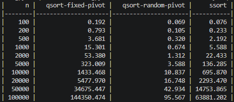
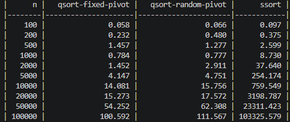
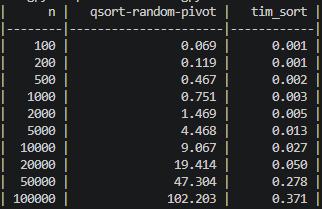
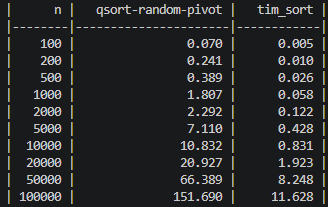

# CMPS 6610 Problem Set 6
## Answers

**Name:**$\underline{\hspace{1in}\text{Rob Hartley}\hspace{1in}}$

Place all written answers from this assignment here for easier grading.

- **1a. (7 pts)**  
  
  Markov's Inequality:    
  
  $P[X \geq \alpha] \leq \frac{E[X]}{\alpha}$  
  
  Quicksort Expected Comparisons:  
  
  $E[X] = O(n \log n)$  

  Number of Comparisons We're Interested In:  

  $\alpha = cn^2$, $c > 0$  

  Substitute into the Equation:  

  $P[X \geq cn^2] \leq \frac{O(n \log n)}{cn^2}$  

  $\boxed{P[X \geq cn^2] \leq O\left(\frac{\log n}{n}\right)}$  

  The probability that Quicksort makes $\Omega(n^2)$ comparisons is at most $O\left(\frac{\log n}{n}\right)$.

- **1b. (8 pts)**  
  
  Markov's Inequality:    
  
  $P[X \geq \alpha] \leq \frac{E[X]}{\alpha}$  
  
  Quicksort Expected Comparisons:  
  
  $E[X] = O(n \log n)$  

  Number of Comparisons We're Interested In:  

  $\alpha = 10^cn \ln n$, $c > 0$  

  Substitute into the Equation:  

  $P[X \geq 10^cn \ln n] \leq \frac{O(n \log n)}{10^cn \ln n}$  

  $\boxed{P[X \geq 10^cn \ln n] \leq O\left(\frac{1}{10^c}\right)}$  

  The probability that Quicksort makes at least $10^cn \ln n$ comparisons is at most $O\left(\frac{1}{10^c}\right)$. As $c$ increases the upper probability bound decreases exponentially. This indicates that the actual number of comparisions is increasingly unlikely to greatly exceed the expected number of comparisons as c grows.

- **2a. (10 pts)**  
  
  Algorithm  $A'(I)$

  1\. Define maximum number of cycles allowed as $k$. $k$ value selection is determined by the desired probability of success $\delta$.  
  2\. Run $A(I)$.  
  3\. Check the result by using $C(A(I))$.  
  4\. If the reult is correct, return the result and report success. END  
  5\. Decrement $k$ by 1.  
  6\. If $k = 0$, return no result and report failure.  END  
  7\. Restart the process at step 2.

  Probability Equation  

  Desired Probability of success: $\delta$  
  Probability of success for one run: $\epsilon$  
  Probability of failure for one run: $(1 - \epsilon)$  
  Probability that all runs fail: $(1 - \epsilon)^k$  
  Probability of at least one successful run: $1 - (1 - \epsilon)^k$  

  Solve for $k$:  

  $1 - (1 - \epsilon)^k \geq \delta$  
  $(1 - \epsilon)^k \leq 1 - \delta$  
  $k \cdot \log(1 - \epsilon) \leq \log(1 - \delta)$  
  $k \geq \frac{\log(1 - \delta)}{\log(1 - \epsilon)}$  

  $\boxed{k = \left\lceil\frac{\log(1 - \delta)}{\log(1 - \epsilon)}\right\rceil}$  

  Work for $A'(I)$  

  The total worst case work for one cycle of $A(I)$ and $C(A(I))$: $O(W(n))$  
  Maximum number of cycles: $\lceil\frac{\log(1 - \delta)}{\log(1 - \epsilon)}\rceil$  

  $\boxed{W_{A'}(n, \delta, \epsilon) \in O\left(W(n)\cdot \left\lceil\frac{\log(1 - \delta)}{\log(1 - \epsilon)}\right\rceil\right)}$

- **2b. (10 pts)**  
  
  Algorithm  $A''(I)$  

  1\. Run $A(I)$.  
  2\. Check the result by using $C(A(I))$.  
  3\. If the reult is correct, return the result and report success. END  
  4\. Restart the process at step 1.  

  Probability Equation  

  Probability of success for one run: $\epsilon$  
  Probability of failure for one run: $(1 - \epsilon)$  
  Probability that the first successful run occurs on cycle $k$: $P(K = k) = (1 - \epsilon)^{k - 1} \cdot \epsilon$  
  Expected value formula: $E[K] = \sum_{k=1}^{\infty} k \cdot P(K=k)$  
  Substitute into expected value formula:  
  $E[K] = \sum_{k=1}^{\infty} k(1-\epsilon)^{k-1}\epsilon$  
  $E[K] = \epsilon \cdot \sum_{k=1}^{\infty} k(1-\epsilon)^{k-1}$  
  Geometric series formula: $\sum_{k=0}^{\infty} x^k = \frac{1}{1-x}$  
  Derivative of geometric series formula: $\sum_{k=1}^{\infty} kx^{k-1} = \frac{1}{(1-x)^2}$  
  Substitute into formula:  
  $E[K] = \epsilon \cdot \frac{1}{(1-(1-\epsilon))^2}$  
  $E[K] =  \frac{\epsilon}{(1 - 1+ \epsilon)^2}$  
  Expected cycles:  
  ${E[K] = \frac{1}{\epsilon}}$  

  Expected Work for $A''(I)$:  
  
  The total worst case work for one cycle of $A(I)$ and $C(A(I))$: $O(W(n))$  
  Expected number of cycles: $\frac{1}{\epsilon}$  
  Expected work:  

  $\boxed{E[W_{A''}(n,\epsilon)] \in O\left(\frac{W(n)}{\epsilon}\right)}$

- **3b. (5 pts)**  
  
  Sorted Run  
  

  Random Run  
    

  | Algorithm | Randomly ordered input (expected runtime) | Sorted input (expected runtime) | Worst case runtime |
  |---|---|---|---|
  | qsort_fixed_pivot | $\Theta(n \log n)$ | $\Theta(n^2)$ | $\Theta(n^2)$ |
  | qsort_random_pivot | $\Theta(n \log n)$ | $\Theta(n \log n)$ | $\Theta(n^2)$ |
  | ssort | $\Theta(n^2)$ | $\Theta(n^2)$ | $\Theta(n^2)$ |  

  These results highlight the peformance benefits of using quick sort algorithms over selection sort, while also showing the effects that maximally unbalanced partition sizes can have on a quicksort algorithm.  

  The runtimes oberved in the two test runs are consistent with what we'd expect to see. For $\Theta(n \log n)$ asymptotic bounds, we see approximately double the running time when we double the input size. For $\Theta(n^2)$ asymptotic bounds, each doubling of input size results in an approximate quadrupling of running time. 
  
  qsort_fixed_pivot always takes the first element as the pivot point. qsort_random_pivot chooses a random pivot point for each partitioning operation. ssort works its way through a list by finding the smallest value in the remaining unsorted portion of the list and swapping it with the element at the current index. This process continues until the entire list is sorted.  

  These differences matter for qsort_fixed_pivot when we go from using a sorted list to a randomized list.
  
  For a sorted list, picking the first entry as the pivot point for each run as qsort_fixed_pivot does automatically picks the smallest number each time. This leads to a maximally unbalanced partition that contains $0$ entries on one side and $(n-1)$ entries on the other. The result is that qsort_fixed_pivot is essentially doing the same thing as ssort; finding the smallest entry, removing it, and reprocessing the rest of the list. This results in a similar asymptotic growth rate in the number of comparisons required to sort the list, and so both ssort and qsort_fixed_pivot have a runtime of $\Theta(n^2)$. For qsort_random_pivot, a presorted list doesn't matter because it will still choose the pivot at random, and so .we can still expect the larger partition to have a size of approximately $\frac{3n}{4}$, with a corresponding $\Theta(n \log n)$ expected runtime.  

  For a randomized input list, the expected asymptotic runtime changes for qsort_fixed_pivot, but remains the same for ssort and qsort_random_pivot. Because the input list is randomized instead of sorted, qsort_fixed_pivot is effectively functioning in the same manner as qsort_random_pivot because the first element of the input that it will use as a pivot is now a random element each time as opposed to being the smallest element each time. This results in an expected larger partition size of approximately $\frac{3n}{4}$ and the same expected $\Theta(n \log n)$ runtime we see with qsort_random_pivot.  

- **3c. (5 pts)**  

    Sorted Run  
  

  Random Run  
    
  
